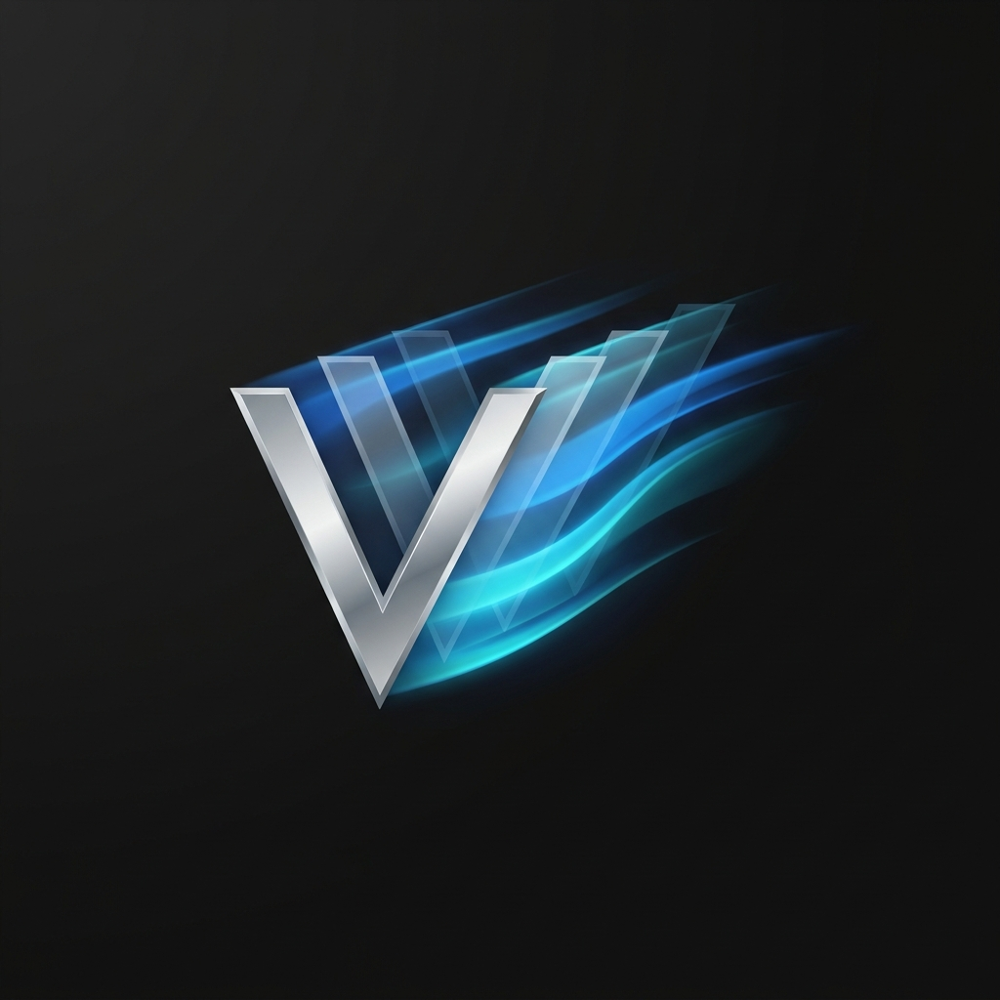
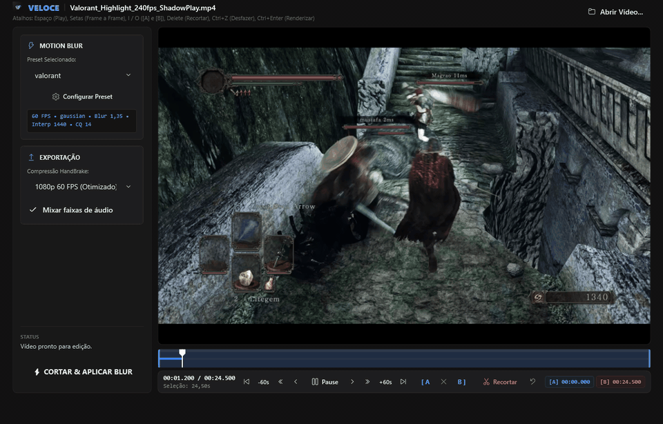
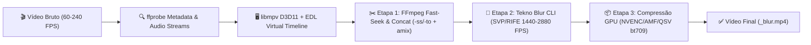

<div align="center">
  
  <h1>⚡ VELOCE</h1>
  <p><strong>Corte Frame-Accurate Estilo Avidemux + Motion Blur Cinematográfico (Tekno Blur / RIFE / SVP) em 1-Click</strong></p>

  <p>
    
    
    
    
    
  </p>
</div>

---

## 🎬 Demonstração do Fluxo em Tempo Real

<div align="center">
  
</div>

---

## 💡 Por que o VELOCE?

Editores de clipes de gameplay (**Valorant, CS2, Call of Duty, Overwatch, Dark Souls**) gravados via **ShadowPlay, OBS ou Medal** a 60, 120 ou 240 FPS sempre sofreram com um fluxo fragmentado: abrir o vídeo no *Avidemux* ou *LosslessCut* para aparar o clipe, exportar um arquivo intermediário, arrastar para o *Tekno Blur* e depois comprimir no *HandBrake*.

O **VELOCE** unifica todo esse ecossistema em uma **única estação nativa Windows 11 Fluent Dark**:
1. **Corte Virtual Instantâneo** com precisão matemática no exato frame exibido na tela.
2. **Concatenação Multi-Segmentos** para remover mortes ou tempos de espera no meio da partida sem perder sincronia de áudio.
3. **Interpolação de Movimento (SVP / RIFE AI) + Frame Blending** via Tekno Blur.
4. **Compressão Hardware-Accelerated (NVENC / AMF / QSV)** pronta para Discord, YouTube ou TikTok.

---

## ✨ Principais Funcionalidades

- 🎯 **Corte Frame-Accurate via Protocolo EDL (`edl://!no_chapters`):**
  Renderização direta acelerada por hardware via `mpv-2.dll` (`gpu-api=d3d11`, `hwdec=auto`) com consulta síncrona de timestamp em **microssegundos (`F6`)** e busca fina (`hr-seek=always`), garantindo que o corte ocorra no exato quadro selecionado — e não no keyframe mais próximo.
- ✂️ **Múltiplos Cortes na Timeline & Pilha de Undo (`Ctrl+Z`):**
  Marque `[A` e `B]` e pressione `Delete` quantas vezes quiser para remover trechos no início, meio ou fim do vídeo. O FFmpeg extrai cada segmento via *fast input seeking* (`-ss / -to`) e os concatena automaticamente via `filter_complex`.
- 🎙️ **Mixagem Automática de Áudio Multifaixa (`amix`):**
  Grava o áudio do jogo e o microfone em faixas separadas no ShadowPlay/OBS? Com a opção **Mixar faixas de áudio**, o VELOCE detecta todas as streams de áudio com `ffprobe` e as funde em uma faixa limpa automaticamente.
- 🌊 **Editor Completo de Presets de Motion Blur:**
  Ajuste visualmente em sliders de alto contraste:
  - **Modos Matemáticos de Ponderação (Weighting):** `gaussian`, `gaussian_sym`, `vegas`, `pyramid`, `equal`, `ascending`, `descending`.
  - **Interpolação de Quadros:** `SVP` (vetores ópticos ultrarrápidos) ou `RIFE AI` (redes neurais) a `720`, `1440` ou `2880 FPS`.
  - **Intensidade de Blur (`0.10` a `3.00`)**, **Correção Gamma (`1.00` a `2.20`)** e **Qualidade NVENC CQ (`10` a `30`)**.
- ⚡ **Auto-Bootstrapper 1-Click:**
  Se o motor `blur-cli.exe` não for encontrado no PC, o VELOCE exibe um banner inteligente que consulta a API do GitHub, baixa a release oficial mais recente e configura o motor automaticamente em `%LOCALAPPDATA%\VELOCE\engine`.
- 🛡️ **Blindagem de Estabilidade & Prevenção de Processos Zumbis:**
  Handlers globais de exceção com log de diagnóstico (`%LOCALAPPDATA%\VELOCE\logs\crash.log`) e encerramento garantido da árvore de processos (`process.Kill(entireProcessTree: true)`) ao cancelar ou fechar o app.

---

## ⌨️ Atalhos de Teclado

| Atalho | Ação |
| :--- | :--- |
| `Espaço` | Play / Pause |
| `Seta Esquerda` / `Seta Direita` | Voltar / Avançar **1 Frame Exato** |
| `Seta Baixo` / `Seta Cima` | Pular para o **Keyframe** Anterior / Próximo |
| `PageDown` / `PageUp` | Voltar / Avançar **60 Segundos** |
| `Home` / `End` | Ir para o Início / Fim da Timeline |
| `I`, `A` ou `[` | Definir Marcador de Início **`[A]`** no Frame Atual |
| `O`, `B` ou `]` | Definir Marcador de Fim **`[B]`** no Frame Atual |
| `X` | Limpar Seleção `[A - B]` |
| `Delete` | **Recortar (Remover)** o Trecho Selecionado `[A - B]` |
| `Ctrl + Z` | **Desfazer** o Último Corte |
| `Ctrl + Enter` | Iniciar Renderização (**`⚡ CORTAR & APLICAR BLUR`**) |

---

## 🏗️ Arquitetura do Pipeline



---

## 🚀 Download & Uso Rápido (Portátil)

O **VELOCE** é distribuído como um pacote **100% Standalone (Self-Contained)** — você **não** precisa instalar o .NET Desktop Runtime nem configurar variáveis de ambiente:

1. Baixe o arquivo **`VELOCE-v1.0.0-win-x64.zip`** na aba [**Releases**](../../releases/latest).
2. Extraia a pasta em qualquer lugar do seu PC e execute o **`VELOCE.exe`**.
3. Arraste um vídeo de gameplay para a janela (ou use *"Abrir com -> VELOCE.exe"* direto pelo Windows Explorer).
4. Use `[A` e `B]` + `Delete` para cortar as partes indesejadas, escolha o preset na barra lateral esquerda e clique em **`⚡ CORTAR & APLICAR BLUR`**.

---

## 🛠️ Compilando do Código-Fonte

### Pré-requisitos
- Windows 10 ou 11 (x64)
- .NET 8.0 SDK

### Comandos

```powershell
# 1. Executar a suíte de testes unitários (xUnit)
dotnet test Veloce.sln -c Release

# 2. Gerar a build final Standalone x64
dotnet publish src/Veloce.App/Veloce.App.csproj -c Release -r win-x64 --self-contained true -o bin/VELOCE
```

---

<div align="center">
  <sub>Desenvolvido com foco em performance, precisão de frames e estética Windows 11 Fluent Dark.</sub>
</div>
